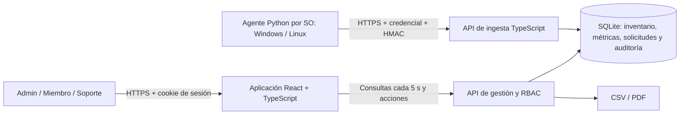

# Arquitectura y decisiones

## Contexto



TypeScript contiene los contratos, reglas y presentación. Python se usa donde aporta acceso al hardware y a herramientas del SO. No se usa Python como un segundo servidor web innecesario.

SQLite con WAL permite un despliegue local de un solo nodo, transacciones, índices de métricas e integridad referencial. La API usa `node:sqlite` de Node 24; ese módulo puede emitir una advertencia de estabilidad experimental del runtime. Las consultas de inventario evitan una consulta por equipo y usan el índice `(equipment_id, observed_at)` para la última medición. El almacenamiento está concentrado en un módulo para permitir una migración futura a PostgreSQL/series temporales si el crecimiento o la carga real lo justifican. No se afirma que la implementación sea multinodo.

## Modelo principal

| Entidad          | Responsabilidad                                                                                |
| ---------------- | ---------------------------------------------------------------------------------------------- |
| users / sessions | Roles, contraseña scrypt, segundo factor de administradores, sesiones hasheadas con expiración |
| equipment        | Identidad del activo, estado vigente, ubicación única, inventario y latido                     |
| agents           | Credencial individual y secreto HMAC por equipo/SO, revocación                                 |
| metrics          | Observación UTC, recepción UTC, SO origen, CPU/RAM/disco/red y marcas de retraso/desvío        |
| receipts         | ID y hash del cuerpo para deduplicación, independiente de la retención de métricas             |
| os_reports       | Último reporte conocido de cada instalación de SO                                              |
| requests         | Solicitud, estado original/destino, solicitante, revisor y decisión                            |
| notifications    | Notificaciones persistidas dirigidas a usuarios                                                |
| audit            | Eventos append-only con cadena SHA-256 y triggers contra UPDATE/DELETE                         |
| settings         | Frecuencias, umbrales, política de ubicación, autoaprobación y matriz de transiciones          |

## Invariantes

1. Registrar una solicitud no modifica el estado vigente.
2. Solo ADMIN aprueba/rechaza, incluso si se llama directamente a la API.
3. La aprobación y su auditoría comparten una transacción `BEGIN IMMEDIATE`.
4. El índice parcial `one_pending_per_equipment` garantiza una sola solicitud pendiente por equipo.
5. La aprobación revalida el estado original y la matriz actual; un cambio concurrente no aplica una transición inválida.
6. Cancelar requiere ser el solicitante; rechazar requiere comentario.
7. La ubicación se registra manualmente, con una única ubicación vigente y auditoría de origen/destino.
8. La conectividad se calcula para el equipo completo; el SO inactivo conserva fecha de última telemetría y situación del agente.
9. El agente de un SO no puede reportar para otro equipo o SO.
10. Un UUID repetido con el mismo cuerpo retorna `duplicate=true`; uno con otro cuerpo se rechaza.
11. Telemetría histórica reenviada no reactiva un equipo fuera de línea ni sobrescribe un inventario más reciente.
12. La auditoría se protege desde la aplicación/base; un administrador del sistema operativo con control de los archivos sigue perteneciendo al límite de confianza. La cadena hash detecta alteraciones no reconstruidas, sin prometer almacenamiento WORM externo.

## Protocolo del agente

`POST /api/ingest`, cuerpo JSON UTF-8, máximo 1 MiB:

```text
Authorization: Bearer <token individual>
Content-Type: application/json
X-Smtel-Sent-At: <fecha ISO 8601 con zona UTC>
X-Smtel-Signature: hex(HMAC-SHA256(secret, sentAt + "." + bytesExactosDelCuerpo))
```

El UUID de observación y el cuerpo se conservan en cada reintento. La fecha de envío se genera y firma nuevamente, para diferenciar un reporte histórico de un reloj desviado. El servidor marca un desvío mayor a 60 s y retiene el reporte para diagnóstico; no permite que un reporte retrasado o desviado actualice la conectividad. No se descarta telemetría recuperada por antigüedad.

El inventario debe indicar exactamente un SO activo; Single exige una instalación y Multi al menos dos. UNKNOWN exige motivo. CPU/RAM/disco deben estar entre 0 y 100. Los rangos de bytes, longitudes y cantidades están acotados. La respuesta contiene hora del servidor y frecuencias configuradas. La revocación se valida en cada envío.

## Acceso web

Sesión aleatoria de 256 bits almacenada mediante hash, cookie HttpOnly/SameSite=Strict y Secure en producción. Expiración por inactividad configurable (30 minutos por defecto) y límite absoluto de 24 horas. El sondeo de fondo no prolonga la sesión; la actividad de usuario sí. Las operaciones que modifican datos exigen un origen autorizado. Login tiene bloqueo temporal después de cinco fallos por correo/IP. Los administradores necesitan TOTP y no pueden reutilizar un paso aceptado. Cambios de rol/desactivación revocan sesiones; se conserva al menos un administrador activo.

## Decisiones abiertas resueltas provisionalmente

| Decisión del anexo B    | Valor implementado                                                                                   |
| ----------------------- | ---------------------------------------------------------------------------------------------------- |
| Aprobación de ubicación | Admin y Soporte autorizado pueden actualizarla directamente; queda auditada. RN-04 gobierna estados. |
| Autoaprobación          | Permitida inicialmente para continuidad de un único administrador; puede desactivarse.               |
| SO del agente           | Windows y Linux; otros reportan UNKNOWN/no soportado.                                                |
| Dual Boot               | Un agente por instalación; SO inferido sin agente se indica expresamente.                            |
| Frecuencia              | Recursos y red 30 s; verificación completa de inventario/arranque 300 s; configurables.              |
| Retención               | Métricas 90 días iniciales; auditoría sin borrado aplicativo y respaldo institucional ≥12 meses.     |
| Autenticación           | Cuentas locales con MFA ADMIN; SSO/LDAP opcional pendiente.                                          |
| Escala                  | Objetivo documental 100 equipos / 50 usuarios; validación sintética adicional a doble escala.        |

Los cuatro estados iniciales y sus etiquetas están centralizados en `packages/shared`; la matriz es configurable desde la interfaz. Añadir nuevos estados al catálogo requiere ampliar el contrato y validar la compatibilidad de clientes/agentes. No se ofrece alta dinámica de nombres de estados en esta versión.

## Exclusiones respetadas

No hay control remoto, instalación de software, inventario de aplicaciones/licencias, lectura de archivos personales ni monitoreo de actividad de usuarios. Las lecturas de archivos se limitan a metadatos técnicos del SO/firmware/arranque y la configuración propia del agente.
